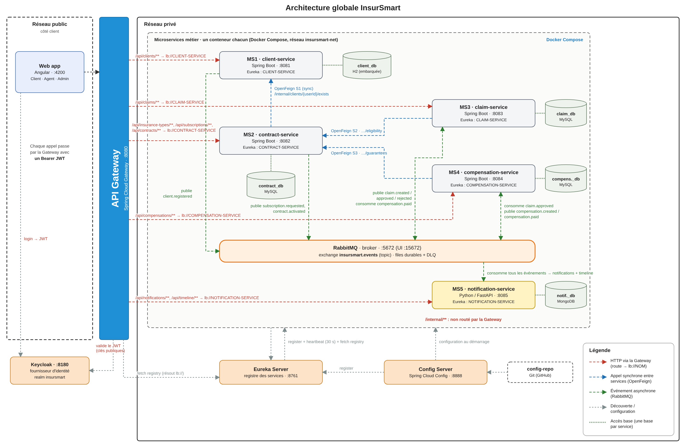
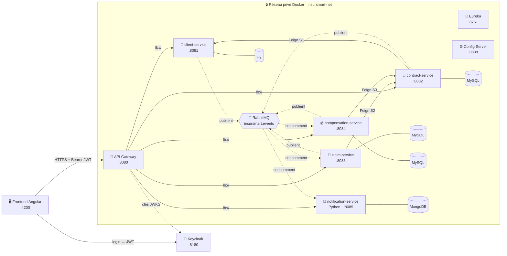
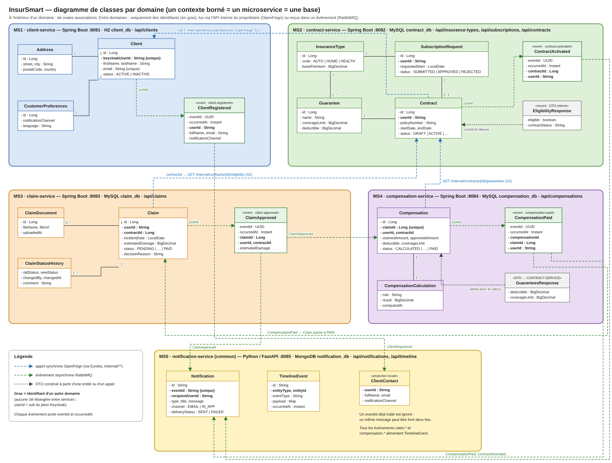
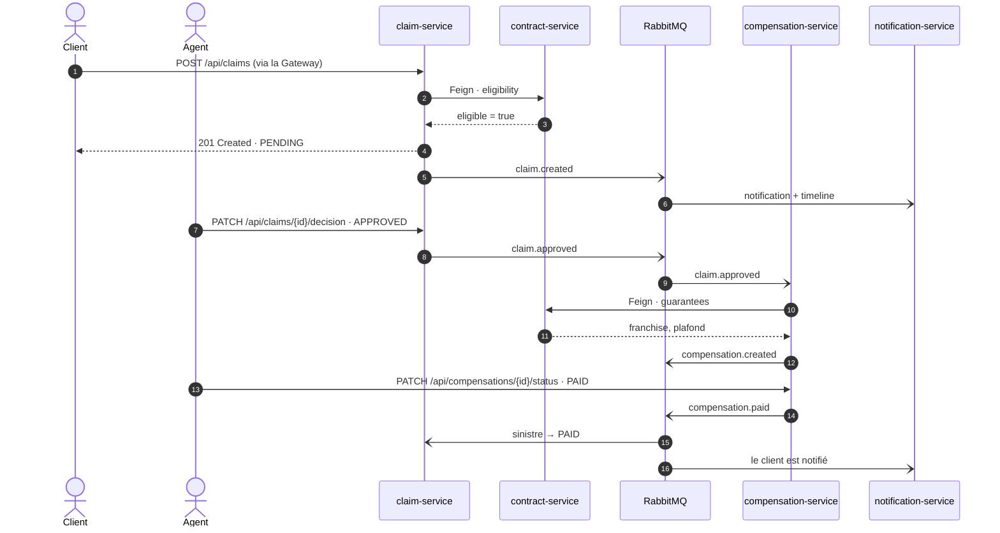
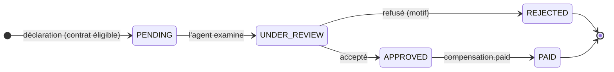

<div align="center">

# 🛡️ InsurSmart

### Plateforme de gestion des assurances en architecture microservices

*Souscrire, déclarer, suivre, être indemnisé : tout le parcours d'assurance, en ligne et traçable.*

<br>


**[Le projet](#-le-projet)** ·
**[Architecture](#-architecture)** ·
**[Microservices](#-les-microservices)** ·
**[Communications](#-communications)** ·
**[Démarrage](#-démarrage-rapide)** ·
**[API](#-api)** ·
**[Équipe](#-équipe)**

</div>

---

## 📌 Le projet

Les démarches d'assurance passent par plusieurs étapes, souvent traitées par téléphone, e-mail ou papier : souscrire, consulter son contrat, déclarer un sinistre, envoyer les justificatifs, attendre la décision, puis l'indemnisation. Le client ne sait jamais où en est son dossier.

**InsurSmart** réunit tout ce parcours dans une seule application Web, construite en microservices :

| | Fonctionnalité | Qui |
|:-:|---|---|
| 📝 | Demande de souscription, validée par un agent : le contrat passe de `DRAFT` à `ACTIVE` | Client · Agent |
| 📄 | Consultation des contrats et de leurs garanties | Client |
| 🚨 | Déclaration d'un sinistre avec pièces jointes, sur un contrat **vérifié éligible** | Client |
| ⚖️ | Examen du dossier, puis acceptation ou refus motivé | Agent |
| 💰 | **Calcul automatique** de l'indemnisation à partir de la franchise et du plafond | Système |
| 🔔 | Notification à chaque étape et **timeline** complète du dossier | Système |
| ⚙️ | Gestion du catalogue (types d'assurance, garanties), des utilisateurs et des rôles | Admin |

> **Règle de calcul** : `approvedAmount = min( max(0, montant réclamé − franchise), plafond )`
> Une seule indemnisation par sinistre (`claimId` unique), et uniquement pour un sinistre `APPROVED`.

---

## 🏗️ Architecture

<div align="center">
  
</div>

<details>
<summary><b>🔎 Vue simplifiée (rendue directement par GitHub)</b></summary>



</details>

### Principes appliqués

- 🧩 **Un contexte borné = un microservice = une base.** Aucune table partagée, aucune clé étrangère entre services : seulement des identifiants (`userId`, `contractId`, `claimId`).
- 🚪 **Un seul point d'entrée.** Le frontend ne parle qu'à l'API Gateway, qui valide le JWT et route par nom Eureka (`lb://CLAIM-SERVICE`).
- 🔁 **Synchrone pour décider, asynchrone pour informer.** OpenFeign quand la réponse est nécessaire pour continuer, RabbitMQ pour diffuser un fait accompli.
- 🛡️ **Tolérance aux pannes.** Timeout, retry et circuit breaker (Resilience4j) ; files durables, DLQ et consommateurs idempotents.
- 🔒 **Endpoints internes protégés.** Les appels inter-services passent par `/internal/**`, que la Gateway ne route jamais.
- 🌍 **Polyglotte.** Quatre services Spring Boot et un service Python / FastAPI : Eureka et RabbitMQ sont indépendants du langage.

---

## 🧱 Les microservices

| | Service | Responsabilité | Techno | Port | Base | Nom Eureka |
|:-:|---|---|---|:-:|---|---|
| 👤 | **client-service** | Profils clients, adresse, préférences ; lien avec le compte Keycloak | Spring Boot 3 | `8081` | H2 | `CLIENT-SERVICE` |
| 📄 | **contract-service** | Catalogue, garanties, souscriptions, contrats ; source de vérité sur la couverture | Spring Boot 3 | `8082` | MySQL `contract_db` | `CONTRACT-SERVICE` |
| 🚨 | **claim-service** | Déclaration, pièces jointes, workflow de statuts, décision de l'agent | Spring Boot 3 | `8083` | MySQL `claim_db` | `CLAIM-SERVICE` |
| 💰 | **compensation-service** | Calcul automatique, historique des calculs, paiement simulé | Spring Boot 3 | `8084` | MySQL `compensation_db` | `COMPENSATION-SERVICE` |
| 🔔 | **notification-service** | Notifications e-mail / in-app, timeline des sinistres | Python 3.12 · FastAPI | `8085` | MongoDB `notification_db` | `NOTIFICATION-SERVICE` |

<details>
<summary><b>🛠️ Services d'infrastructure</b></summary>

| Composant | Technologie | Port | Rôle |
|---|---|:-:|---|
| **api-gateway** | Spring Cloud Gateway | `8080` | Point d'entrée unique, validation du JWT, routage `lb://` |
| **eureka-server** | Spring Cloud Netflix Eureka | `8761` | Registre et découverte des services |
| **config-server** | Spring Cloud Config | `8888` | Configuration centralisée lue dans `config-repo/` |
| **Keycloak** | Keycloak (realm `insursmart`) | `8180` | Authentification OAuth2 / OIDC, rôles `CLIENT`, `AGENT`, `ADMIN` |
| **RabbitMQ** | RabbitMQ management | `5672` / `15672` | Exchange topic `insursmart.events`, files durables, DLQ |
| **Frontend** | Angular + keycloak-angular | `4200` | Interface Client, Agent, Admin |

</details>

### Modèle du domaine

<div align="center">
  
  <br><sub>Un cadre par microservice. En gras : les identifiants venant d'un autre domaine.</sub>
</div>

---

## 🔄 Communications

### Synchrones · OpenFeign

| # | Appel | Endpoint | Si le service appelé tombe |
|:-:|---|---|---|
| S1 | contract → client | `GET /internal/clients/{userId}/exists` | `503`, aucune souscription créée |
| S2 | claim → contract | `GET /internal/contracts/{id}/eligibility?userId=&incidentDate=` | `503`, aucun sinistre créé |
| S3 | compensation → contract | `GET /internal/contracts/{id}/guarantees` | Calcul reporté : retry, puis DLQ |

### Asynchrones · RabbitMQ (`insursmart.events`, type topic)

| Routing key | Producteur | Consommateurs |
|---|---|---|
| `client.registered` · `client.updated` | client | notification |
| `subscription.requested` · `contract.activated` | contract | notification |
| `claim.created` · `claim.rejected` | claim | notification |
| `claim.approved` | claim | **compensation**, notification |
| `compensation.created` | compensation | notification |
| `compensation.paid` | compensation | **claim** (statut `PAID`), notification |

<details>
<summary><b>📨 Format commun d'un événement</b></summary>

```json
{
  "eventId": "3f1c9a2e-8b7d-4c1e-9f0a-2d6b5e8c7a41",
  "eventType": "claim.created",
  "occurredAt": "2026-11-06T10:15:00Z",
  "producer": "claim-service",
  "payload": { "claimId": 501, "userId": "abc-123", "contractId": 102, "status": "PENDING" }
}
```

L'`eventId` rend les consommateurs **idempotents** : un message livré deux fois ne produit qu'un seul effet.

</details>

### Le scénario clé : du sinistre au paiement



<details>
<summary><b>🔀 Cycle de vie d'un sinistre</b></summary>



</details>

---

## 🚀 Démarrage rapide

### Prérequis

| Outil | Version |
|---|---|
| Docker et Docker Compose | récents |
| Java (JDK) | 17 |
| Maven | 3.9+ (ou le wrapper `./mvnw`) |
| Python | 3.12 |
| Node.js | 20+ (frontend) |

### Option 1 · Tout l'environnement avec Docker

```bash
git clone https://github.com/<compte>/insursmart-<classe>-g<numero>.git
cd insursmart-<classe>-g<numero>
docker compose up --build
```

### Option 2 · En local, service par service

```bash
# 1. Infrastructure (bases, RabbitMQ, Keycloak)
docker compose up -d mysql-contract mysql-claim mysql-compensation mongodb rabbitmq keycloak

# 2. Dans cet ordre
cd Backend/config-server && ./mvnw spring-boot:run
cd Backend/eureka-server && ./mvnw spring-boot:run
cd Backend/api-gateway   && ./mvnw spring-boot:run

# 3. Les microservices Spring Boot (un terminal chacun)
cd Backend/client-service && ./mvnw spring-boot:run      # idem pour contract, claim, compensation

# 4. Le microservice Python
cd Backend/notification-service
python -m venv .venv && source .venv/bin/activate
pip install -r requirements.txt
uvicorn app.main:app --reload --port 8085

# 5. Le frontend
cd Frontend && npm install && ng serve
```

### 🔗 URL utiles

| Service | URL |
|---|---|
| 🖥️ Frontend | http://localhost:4200 |
| 🚪 API Gateway | http://localhost:8080 |
| 📒 Tableau de bord Eureka | http://localhost:8761 |
| 🔐 Console Keycloak | http://localhost:8180 |
| 🐇 Console RabbitMQ | http://localhost:15672 |
| 📘 Swagger d'un service Spring Boot | http://localhost:808X/swagger-ui.html |
| 📗 Swagger de notification-service | http://localhost:8085/swagger-ui |

<details>
<summary><b>👥 Comptes de test (realm <code>insursmart</code>)</b></summary>

| Rôle | Utilisateur | Mot de passe |
|---|---|---|
| CLIENT | `[client1]` | `[à définir]` |
| AGENT | `[agent1]` | `[à définir]` |
| ADMIN | `[admin1]` | `[à définir]` |

Le realm est exporté en JSON et importé automatiquement au démarrage du conteneur Keycloak.

</details>

---

## 📡 API

Toutes les routes passent par la Gateway (`http://localhost:8080`) avec l'en-tête `Authorization: Bearer <jwt>`.

| Préfixe | Service | Exemples |
|---|---|---|
| `/api/clients/**` | client-service | `GET /api/clients/me` · `PUT /api/clients/me/preferences` |
| `/api/insurance-types/**` · `/api/subscriptions/**` · `/api/contracts/**` | contract-service | `POST /api/subscriptions` · `PATCH /api/subscriptions/{id}/decision` |
| `/api/claims/**` | claim-service | `POST /api/claims` · `PATCH /api/claims/{id}/decision` |
| `/api/compensations/**` | compensation-service | `GET /api/compensations/claim/{claimId}` |
| `/api/notifications/**` · `/api/timeline/**` | notification-service | `GET /api/notifications/me` · `GET /api/timeline/claims/{id}` |
| `/internal/**` | — | ⛔ jamais routé par la Gateway |

<details>
<summary><b>🧪 Exemple : déclarer un sinistre</b></summary>

```http
POST /api/claims HTTP/1.1
Host: localhost:8080
Authorization: Bearer <jwt>
Content-Type: application/json

{
  "contractId": 102,
  "incidentDate": "2026-11-05",
  "description": "Collision à faible vitesse",
  "incidentLocation": "Tunis",
  "estimatedDamage": 1800.00
}
```

```json
201 Created
{ "id": 501, "status": "PENDING", "createdAt": "2026-11-06T10:15:00" }
```

Puis, une fois le sinistre accepté, l'indemnisation est créée automatiquement :

```json
GET /api/compensations/claim/501  →  200 OK
{ "id": 77, "claimId": 501, "claimedAmount": 1800.00, "deductible": 200.00,
  "coverageLimit": 5000.00, "approvedAmount": 1600.00, "status": "CALCULATED" }
```

</details>

Les erreurs suivent la norme **RFC 7807** (`application/problem+json`) : `status`, `title`, `detail`, et la liste des champs invalides pour une erreur `400`.

---

## 🔐 Sécurité

```text
Frontend ──(Authorization Code + PKCE)──▶ Keycloak ──▶ JWT (rôles)
    │
    └──(Bearer JWT)──▶ API Gateway : vérifie la signature (JWKS)  → 401 sinon
                           │
                           └──▶ Microservice : vérifie le rôle et la propriété → 403 sinon
                                   (userId du jeton = userId de la ressource)
```

- Aucun mot de passe stocké dans client-service : l'identité vient du `sub` Keycloak.
- Seuls le frontend, la Gateway et Keycloak sont exposés ; les services et les bases restent dans le réseau privé.

---

## 📂 Structure du dépôt

```text
insursmart-<classe>-g<numero>/
├── 📁 Backend/
│   ├── config-server/          Spring Cloud Config
│   ├── eureka-server/          registre des services
│   ├── api-gateway/            point d'entrée unique
│   ├── client-service/         MS1 · Spring Boot · H2
│   ├── contract-service/       MS2 · Spring Boot · MySQL
│   ├── claim-service/          MS3 · Spring Boot · MySQL
│   ├── compensation-service/   MS4 · Spring Boot · MySQL
│   └── notification-service/   MS5 · Python / FastAPI · MongoDB
├── 📁 Frontend/                application Angular
├── 📁 config-repo/             un fichier par service + application.properties commun
├── 📁 Documentation/
│   ├── Presentation/           support de la validation
│   ├── Diagrams/               architecture, domaine, classes, séquence, états
│   └── InsurSmart_Dossier_Technique.docx
├── 🐳 docker-compose.yml
└── 📘 README.md
```

<details>
<summary><b>🗂️ Organisation interne d'un microservice</b></summary>

**Spring Boot** (`tn.esprit.insursmart.<service>`)

```text
├── config/       OpenApiConfig, SecurityConfig, RabbitConfig, FeignConfig
├── controller/   endpoints REST documentés (Swagger)
├── dto/          records Request / Response validés (jamais d'entité exposée)
├── entity/       entités JPA
├── exception/    GlobalExceptionHandler, ResourceNotFoundException, ConflictException
├── mapper/       entité ↔ DTO
├── repository/   Spring Data JPA
├── service/      logique métier
├── client/       interfaces OpenFeign + fallback
└── messaging/    publishers et listeners RabbitMQ
```

**FastAPI** (`notification-service/app`)

```text
├── main.py       application, Swagger sur /swagger-ui
├── routers/      notifications, timeline
├── schemas.py    modèles Pydantic
├── services/     logique (idempotence, lecture)
├── repository/   MongoDB (motor)
├── messaging/    consommateur RabbitMQ (aio-pika)
└── security.py   validation du JWT Keycloak
```

</details>

---

## 🗺️ Feuille de route

- [x] **S1 – S3** · Sujet, découpage, contrats d'API, dépôt Git
- [x] **S4** · Validation de la conception : dossier, présentation, diagrammes, projets initialisés
- [ ] **S5** · Gateway, Eureka, Config Server, CRUD de chaque service
- [ ] **S6** · Appels synchrones OpenFeign + Resilience4j
- [ ] **S7** · Événements RabbitMQ et notification-service
- [ ] **S8** · Sécurité Keycloak et contrôle des rôles
- [ ] **S9** · Dockerisation complète et frontend
- [ ] **S10** · Démonstration et soutenance

---

## 👥 Équipe

| Membre | Microservice | Partie groupe |
|---|---|---|
| **[Étudiant 1]** | 👤 client-service | Keycloak et sécurité de la Gateway |
| **[Étudiant 2]** | 📄 contract-service | API Gateway, Eureka, Config Server |
| **[Étudiant 3]** | 🚨 claim-service | RabbitMQ, pages sinistres du frontend |
| **[Étudiant 4]** | 💰 compensation-service | Docker Compose et Dockerfiles |
| **Toute l'équipe** | 🔔 notification-service | Frontend, intégration, documentation |

### 🤝 Comment on travaille

- **Branches** : `main` (stable) ← `develop` (intégration) ← `feature/<service>-<sujet>`
- **Pull requests** relues par au moins un autre membre avant la fusion
- **Commits** normalisés : `feat(claim-service): …`, `fix(…)`, `docs: …`, `chore: …`
- **Suivi des tâches** : [GitHub Projects](https://github.com/<compte>/insursmart-<classe>-g<numero>/projects), une carte par tâche

---

## 📚 Documentation

| Document | Contenu |
|---|---|
| 📕 [Dossier technique](Documentation/InsurSmart_Dossier_Technique.docx) | Conception complète : analyse, découpage, données, architecture, API, interactions, planning |
| 📊 [Présentation](Documentation/Presentation/) | Support de la validation intermédiaire |
| 🖼️ [Diagrammes](Documentation/Diagrams/) | Architecture, cas d'utilisation, domaine global et par service, classes, séquence, états |

---

<div align="center">

**InsurSmart** · ESPRIT · Module AWD (Applications Web Distribuées) · 2026-2027

<sub>Projet pédagogique : paiement simulé, aucune donnée réelle.</sub>

</div>
